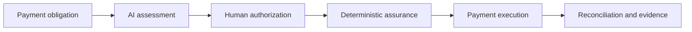

# Tameion

**Assured payment control for finance teams.**

Tameion is a prototype accounts-payable command center. It helps a finance
operator review payment obligations, receive an AI recommendation, authorize an
exact payment instruction, apply deterministic safety controls, execute through
an approved provider, and reconcile the recorded outcome.

AI is advisory. It can recommend `PAY`, `HOLD`, or `ESCALATE`, but it cannot
approve or release money. Human authorization, deterministic assurance, signed
instruction verification, provider checks, and reconciliation remain separate
controls.

The repository contains production-shaped control paths, a protected operator
experience, and a clearly separated local synthetic walkthrough. It is a
private prototype and does not claim production release or mainnet readiness.

## Submission status (read this first)

| Item | Status |
| --- | --- |
| Submitted candidate | [`e182e89`](https://github.com/habrahgithub/swd-tameion-assured-payments/tree/e182e89a0daffb3e4d864b791a62e4f4ef524f70), merged into `main` through [PR #76](https://github.com/habrahgithub/swd-tameion-assured-payments/pull/76). |
| Submitted demo video | [Tameion — Simulated prototype walkthrough](https://youtu.be/Gq4nZr4hFKk) (2:09). It shows a **simulated** flow. **No real payment occurred**, and it is not evidence of hosted or testnet execution. |
| Production build | Vercel reports a `READY` Production-target build for exact commit `e182e89`. This is build evidence only. |
| Live production domain | Promotion and runtime behavior at `https://tameion.starwealthdynamics.org` have **not been verified** for that build. See [Hosted deployment status](#hosted-deployment-status). |
| Live Arc Testnet UAT | **Pending.** No live testnet walkthrough has been recorded or verified. |
| Real supplier settlement | **Not demonstrated.** Testnet USDC is not a supplier payment. |
| Usage and traction | Internal pilot only. There is no external traction, and this repository publishes no AI-accuracy or payment-volume metrics. |

## Product journey



1. **Obligation** — review the source amount, currency, counterparty context,
   due information, and supporting evidence.
2. **Assessment** — receive an advisory `PAY`, `HOLD`, or `ESCALATE`
   recommendation with findings and supporting detail.
3. **Authorization** — an approved finance operator reviews the exact payment
   instruction and records a human decision.
4. **Assurance** — deterministic controls verify current authority, evidence,
   amount, destination, currency, wallet, policy, expiry, and replay safety.
5. **Payment** — the execution worker may submit at most one approved economic
   intent through the configured provider.
6. **Reconciliation** — provider and chain truth are recorded against the same
   instruction, producing a durable outcome and evidence trail.

The interface distinguishes the stage being reviewed from the workflow's
authoritative current position. A permanent action strip shows the selected
obligation, amount, current state, responsible actor, and one legal next action.

## Current prototype status

| Capability | Current state |
| --- | --- |
| Secure operator sign-in | Implemented with server-side verification, durable sessions, CSRF/origin controls, logout, expiry, and throttling. Hosted operator provisioning is currently deferred. |
| Protected dashboard | Implemented and fail-closed. Private content is unavailable without a verified session and deployment policy. |
| Private obligation view | Implemented as a separately approved, read-only source path. Public genuine-source data remains withdrawn. |
| Arc Testnet USDC balance | Manual authenticated refresh is implemented using a server-pinned Circle read-only capability. Hosted configuration and owner UAT remain pending. |
| Six-stage command center | Implemented for obligation review through reconciliation, with server-derived authority and stage facts. |
| Local synthetic walkthrough | Available on loopback only and labelled `SIMULATED / NON-ECONOMIC / NOT_VENDOR_PAYMENT`. |
| Provider-backed financial journey | Production-shaped modules and network-denied tests exist. Complete hosted obligation-to-reconciliation acceptance remains held behind separate authority and provider gates. |
| Mainnet or production release | Out of scope. |

The current delivery history is tracked in
[Job #65](https://github.com/habrahgithub/swd-tameion-assured-payments/issues/65)
and merged [PR #76](https://github.com/habrahgithub/swd-tameion-assured-payments/pull/76).
[PR #70](https://github.com/habrahgithub/swd-tameion-assured-payments/pull/70)
is closed historical work and is not the current delivery PR.
Passing local tests, CI, or a Vercel build does not by itself establish hosted
login, a verified wallet balance, payment authority, or release approval.

## Core safety principles

### AI advice is not payment authority

The Finance Agent produces structured advice and evidence. A `PAY`
recommendation does not approve a payment, prove wallet funding, create a signed
instruction, or authorize provider submission.

### One authorization binds one exact intent

Human approval binds the selected obligation, amount, currency, destination,
network, source wallet, evidence identity, assessment identity, policy version,
and current aggregate version. A material change invalidates prior authority.

### Deterministic controls decide release

The Safety Kernel, not the AI model, determines whether an approved instruction
is eligible for release. Missing, stale, ambiguous, mismatched, expired, or
revoked evidence fails closed.

### One instruction permits at most one submission

Signed payment envelopes, reservations, idempotency keys, durable execution
records, and provider reconciliation protect against replay and duplicate
submission.

### Unknown outcomes are never retried blindly

A timeout or ambiguous provider result remains `UNKNOWN` or
`OUTCOME_UNVERIFIED`. The affected intent stays locked until reconciliation
establishes provider truth. An unknown outcome is not converted into a safe
retry or a claimed refusal.

### Login grants viewing access only

Signing in allows an approved operator to enter the private workspace. It does
not grant assessment, approval, signing, assurance, payment, or reconciliation
authority.

## Genuine, private, and synthetic data

The three evidence modes are deliberately separate:

| Mode | Purpose | Financial meaning |
| --- | --- | --- |
| Public genuine-source lane | Public application source data | Withdrawn from the current candidate. An empty queue does not prove that no business obligations exist. |
| Private operator view | Approved read-only commercial records bound to existing durable state | Permits viewing only. It does not restore financial eligibility or execution authority. |
| Local synthetic walkthrough | Product demonstration and browser assurance | Invented, non-economic, non-persistent, and never a vendor payment. |

There is no production fallback from missing genuine data to synthetic data.
Browser mocks and test fixtures never populate the genuine server queue.

Source withdrawal does not delete existing durable history. Recorded
assessments, authorizations, execution states, and reconciliation evidence are
preserved, while new action remains blocked when source authority is absent.

## Operator experience

### Signed out

The root route checks the server-side operator session. A missing session shows
normal sign-in guidance. Origin, ingress, or service failures use distinct
non-leaking messages. Private obligations and wallet functions are not mounted
until the session is verified.

### Signed in

The first dashboard view provides:

- the protected obligation queue;
- a manually refreshed Arc Testnet USDC balance with network and observation
  time;
- a selected-obligation summary;
- the six-stage workflow navigator;
- one current legal action;
- collapsed operational, activity, and audit evidence.

Wallet availability is informational. It does not determine the AI
recommendation and does not replace the fresh funding and fee checks required
before a payment.

### Responsive and accessible behavior

The command center is tested at desktop and mobile widths, including 390 px,
320 px, 200% zoom, and a 400%-equivalent reflow viewport. Controls use visible
focus states, meaningful status announcements, minimum touch targets, and
automated axe checks. Stage headings retain their decision or status as the
accessible name while separately describing the reviewed and current workflow
positions.

## Architecture

| Area | Responsibility |
| --- | --- |
| Next.js application | Operator login, dashboard, command center, protected routes, and local demonstration surface. |
| Finance Agent | Structured advisory assessment and evidence generation. |
| Authority aggregate | Current obligation, assessment, authorization, assurance, execution, and reconciliation state. |
| Safety Kernel | Deterministic release controls independent of model output. |
| Payment Authorization Envelope | Canonical signed instruction binding the exact approved intent. |
| Execution worker | Final currentness checks, idempotent provider submission, durable outcome handling, and reconciliation. |
| Supabase/Postgres | Durable application state, operator verifier, sessions, challenges, throttling, and audit history. |
| Circle developer-controlled wallets | Arc Testnet wallet observation and separately gated payment-provider capability. |
| Vercel Preview / Production | Protected hosted environments. Preview binds an exact deployment ID and origin; Production binds an exact Git commit SHA, origin and configuration digest. Vercel reports a `READY` Production-target build for `e182e89`; live custom-domain promotion and runtime UAT remain unverified. |

The application uses server-derived authority and workflow facts. The browser
does not recreate payment eligibility or infer release authority from visible
state.

### AI advisory versus deterministic execution

| Advisory (can be wrong, cannot move money) | Deterministic (decides, independent of model output) |
| --- | --- |
| Finance Agent assessment: `PAY`, `HOLD`, `ESCALATE`, findings, supporting detail | Current authority and designated approver |
| Optional live model assessment (`NVIDIA_API_KEY`); a deterministic fallback exists and is labelled | Exact-intent binding: amount, currency, destination, wallet, policy, expiry |
| Presentation of recommendations in the command center | Signed Payment Authorization Envelope and signature verification |
| | Safety Kernel release checks, replay protection, one submission per instruction |
| | Provider checks, idempotent execution, `UNKNOWN` outcomes held for read-only reconciliation, never retried blindly |

### Circle and Arc Testnet

Arc Testnet USDC is observed through a server-pinned, read-only Circle
developer-controlled-wallet capability and, when separately authorized, used by
the execution worker. The wallet, network and token identity are chosen by the
server, never by the browser. Testnet USDC is a test asset and is not a
supplier payment.

## Authentication and access controls

The single-operator prototype uses:

- a server-held `scrypt` password verifier with random salt;
- an opaque session carried in a host-only, `Secure`, `HttpOnly`, `SameSite`
  cookie;
- durable session validation and revocation;
- bounded login challenges and shared throttling;
- CSRF and exact-origin checks on state-changing requests;
- deployment ID, project ID, environment, and origin equality checks;
- `Cache-Control: no-store` on private responses;
- generic authentication errors without account enumeration;
- server-only credentials and provider configuration.

Passwords, password verifiers, service-role keys, provider keys, signing keys,
and raw provider payloads must never be committed, posted to issues, placed in
browser storage, or exposed through `NEXT_PUBLIC_*` variables.

## Wallet balance boundary

The dashboard balance action is intentional and read-only. The server chooses
the wallet and token identity; the browser cannot supply an arbitrary wallet,
network, token, or address.

The current reader:

- uses the supported Circle SDK capability;
- performs one bounded token-balance collection read without retries or cursor
  following;
- requires terminal pagination evidence;
- selects the approved native Arc Testnet USDC identity;
- validates network, native status, precision, and absence of a token address;
- preserves the exact provider decimal string;
- revalidates the operator session across provider reads;
- returns a narrow amount, asset, network, observation time, and verification
  state;
- returns `BALANCE_NOT_VERIFIED` on missing or ambiguous evidence.

A displayed balance does not prove affordability, fee coverage, payment
readiness, or authority to transfer.

## Payment and reconciliation boundary

The intended execution model is:

```text
PaymentRun
  └─ PaymentIntent
       ├─ AllocationManifest
       ├─ Human authorization
       ├─ Deterministic assurance
       ├─ Signed payment envelope
       ├─ Provider submission record
       └─ Reconciliation evidence
```

For the prototype payment lane:

- executable obligations must be USD-denominated;
- settlement uses Arc Testnet USDC;
- no implicit FX conversion is permitted;
- source-wallet spendability and fees require fresh pre-submit evidence;
- one signed envelope represents one exact economic effect;
- destination, amount, evidence, allocation, or authority changes invalidate
  the prior instruction;
- provider-confirmed mismatches become `RECOVERY_REQUIRED`, not a fictional
  blocked payment;
- reconciliation preserves actual provider truth.

Testnet execution is still an external financial effect and remains separately
authorized. Synthetic tests cannot grant live provider authority.

## Application surfaces

| Path | Purpose |
| --- | --- |
| `/` | Protected operator dashboard and command center. |
| `/operator/login` | Single finance-operator sign-in. |
| `/local-demo` | Loopback-only synthetic walkthrough. It refuses hosted and cross-origin activation. |

The API surface includes protected operator session routes, obligation reads,
assessment and authorization controls, wallet refresh, execution and
reconciliation routes, plus internal demonstration and provider-validation
routes. Route presence does not imply runtime admission; sensitive handlers
remain fail-closed unless their full authority and configuration are present.

## Local development

### Requirements

- Node.js **24.21.0**
- npm **11.19.0**
- the dependency versions recorded in `package-lock.json`
- Chromium compatible with the repository Playwright configuration for browser
  verification

Use the pinned Node runtime. Older Node versions can produce misleading module
or packaging failures.

### Install

```bash
npm ci
```

Do not use global package installation or update dependencies as part of a
routine local run.

### Start the application

```bash
npm run dev
```

Open `http://127.0.0.1:3000`. Without approved operator and deployment
configuration, the protected application must remain unavailable rather than
creating a local authentication bypass.

### Run the local synthetic walkthrough

For the reviewed production-build shape:

```bash
npm run build
npm run start -- --hostname 127.0.0.1 --port 3190
```

Then open `http://127.0.0.1:3190/local-demo` directly from the loopback browser
context. The walkthrough has no credentials, persistence, database mutation,
provider write, or genuine obligation import. Reloading discards its
browser-memory state.

## Verification

Run the complete repository verification with:

```bash
npm run verify
```

This executes:

```bash
npm run check:hygiene
npm run typecheck
npm test
npm run build
npm run test:visual
```

The test suites cover unit, integration, failure, security, in-process race
conditions, browser, accessibility, responsive, and visual behavior. Provider
and payment tests use controlled fakes or network-denied capabilities unless a
separate live operation has been explicitly authorized. Committed-database
concurrency and live-provider proof remain separate controlled checks.

Image comparisons depend on the reviewed Chromium and font environment. Do not
replace visual baselines solely to hide an environment mismatch.

## Configuration

`.env.example` contains names with empty values only. Never commit populated
environment files.

The protected operator journey uses these configuration classes:

| Purpose | Names |
| --- | --- |
| Durable application state | `SUPABASE_URL`, `SUPABASE_SERVICE_ROLE_KEY`, `TAMEION_STATE_NAMESPACE` (selects the existing state namespace) |
| Operator identity and ingress | `TAMEION_OPERATOR_KEY`, `TAMEION_ALLOWED_ORIGINS`, `TAMEION_INGRESS_MODE`, `TAMEION_THROTTLE_HMAC_KEY` |
| Read-only wallet observation | `TAMEION_BALANCE_PIN`, `CIRCLE_API_KEY` |
| Approved operator source | `TAMEION_OPERATOR_SOURCE_DOCUMENT`, `TAMEION_OPERATOR_SOURCE_SHA256` |
| Deployment approval record (sole source for Production; carries the configuration digest) | `TAMEION_INGRESS_RECORD` |
| Optional live assessment | `NVIDIA_API_KEY` |
| Payment signing/execution | `CIRCLE_ENTITY_SECRET`, the PAE signing key variable `PAE_SIGNING_KEY_TAMEION_DEMO_PAE_KEY_1_PEM`, and the controlled financial source/requester settings (`TAMEION_FINANCIAL_SOURCE_DOCUMENT`/`_SHA256`, `TAMEION_FINANCIAL_REQUESTER_DOCUMENT`/`_SHA256`), admitted separately from login and balance review |

All of the above are names only. This repository never contains their values,
and setup must not place values in code, commands, logs or issue text.

`.env.example` lists only a subset of these names. The protected operator journey
also requires Vercel-provided deployment variables (`VERCEL`, `VERCEL_ENV`,
`VERCEL_PROJECT_ID`, and `VERCEL_DEPLOYMENT_ID` or `VERCEL_GIT_COMMIT_SHA`) and an
approved deployment record, so it cannot be run locally. What is reproducible
locally is `npm ci`, `npm run verify`, and the loopback `/local-demo` walkthrough
described under Local development.

Deployment approval is bound to an exact Vercel project, deployment,
environment, and approved origin. It is packaged as a private server build
input or supplied through an exactly matching legacy record. The application
rejects missing, stale, malformed, ambiguous, or mismatched approval data.

Configuration names are documentation, not permission to read, copy, widen, or
use secret values.

## Hosted deployment and UAT

A normal successful Git deployment is sufficient for build evidence, but it is
not sufficient for protected hosted acceptance. The controlled Preview process
is:

1. bind the accepted Git SHA, clean tree, project, team, and protected access
   policy;
2. provision the approved operator and minimal branch-scoped configuration;
3. reserve exactly one Preview deployment;
4. approve its actual deployment ID and HTTPS origin;
5. package the exact non-secret deployment approval into the build;
6. build and inspect the server output for approval inclusion and client/static
   exclusion;
7. continue the same reserved deployment without creating a replacement;
8. verify source, project, deployment, origin, and access protection;
9. perform bounded owner login, manual balance refresh, logout, expiry, and
   desktop/mobile UAT.

An ambiguous reservation, upload, provider response, or durable database result
is preserved and adjudicated. It is not retried by creating a replacement
deployment or replaying an uncertain operation.

See [Hosted UAT deployment approval transport](docs/demo/HOSTED-UAT-DEPLOYMENT.md)
for the detailed operational contract.

## Repository map

```text
app/                    Next.js pages, command center, and API route adapters
src/agent/              Finance Agent schemas, context, findings, and provider boundary
src/authority/          Obligation authority aggregate and actor authority
src/domain/             Shared contracts, numeric rules, currency and control boundaries
src/execution/          Provider adapters, execution worker, and outcome handling
src/pae/                Canonical signing, verification, keys, and durable envelopes
src/pipeline/           Authorization and exact approval-packet construction
src/safety-kernel/      Deterministic assurance controls
src/server/             Protected repositories, access policy, read models, and route handlers
src/demo/               Local and controlled testnet demonstration capabilities
supabase/migrations/    Durable state and operator-access database migrations
tests/                  Unit, integration, security, failure, and regression coverage
e2e/                    Playwright browser, accessibility, responsive, and visual assurance
docs/                   Architecture, decisions, evidence, runbooks, and frozen design inputs
scripts/                Hygiene and private build-input packaging/verification helpers
```

## Key documents

- [Public architecture and decisions](docs/DECISIONS.md)
- [Combined M1/M2 UAT candidate](docs/demo/M1-M2-UAT-CANDIDATE.md)
- [Hosted UAT deployment process](docs/demo/HOSTED-UAT-DEPLOYMENT.md)
- [Local judge walkthrough](docs/demo/JUDGE-WALKTHROUGH.md)
- [Demonstration runbook](docs/demo/DEMO-RUNBOOK.md)
- [Demonstration evidence checklist](docs/demo/DEMO-EVIDENCE-CHECKLIST.md)
- [Frozen design baseline](docs/frozen-design/v1.4.22/tameion-full-blueprint.v1.md)

## Change and release discipline

Tameion follows bounded, evidence-led delivery:

1. bind the Job, exact baseline, scope, exclusions, acceptance criteria, and
   typed stop conditions;
2. use one writer, one branch, and one worktree;
3. reproduce material defects before correcting them;
4. make the smallest durable change and add behavioral regression coverage;
5. run focused, adjacent, and full verification;
6. record the exact candidate head, tree, changed paths, checks, and known
   limits;
7. obtain independent exact-head review appropriate to the risk;
8. keep merge, deployment, credentials, provider calls, database effects, and
   payment authority as separate decisions.

Do not weaken a fail-closed control to make a demonstration pass. Do not infer
live authority from mocks, screenshots, local tests, CI, or a READY deployment.

## Hosted deployment status

Status below separates build evidence from live-domain and UAT evidence. It is
not a release claim.

- **Observed 2026-10-18:** Vercel reports deployment
  `dpl_CN7arwTEP9rw391pJqpEef9Rxg3S` as a `READY` Production-target build of
  exact commit `e182e89`. This does not verify that the customer domain serves
  that build or that its protected runtime works.
- **Observed 2026-10-17T23:01Z:** an anonymous request to `https://tameion.starwealthdynamics.org/` returned
  HTTP 200, and `/api/operator/session` returned HTTP 404 (responses were CDN cache hits).
  That indicates the deployment serving that domain lacks this candidate's operator API,
  so it is not `e182e89`.
- **Not verified:** protected sign-in, dashboard, obligation views, wallet connectivity,
  or any payment workflow on the production URL.
- **Required before this section can change:** the exact approved commit deployed to
  Production, the production configuration provisioned and independently reviewed, and
  recorded evidence of the checks above. Deployment alone does not establish a successful
  testnet execution or reconciliation, and neither establishes real supplier settlement.

### Live testnet UAT (pending)

| Evidence | Status |
| --- | --- |
| Production-target build of the approved commit | `READY` for `e182e89`; build evidence only |
| Promotion of that build to the live customer domain | Not verified |
| Protected sign-in and dashboard on the production URL | Pending |
| Wallet balance refresh (Arc Testnet USDC) | Pending |
| Owner-operated testnet transaction and its outcome | Pending; no testnet transaction is recorded for this candidate |
| Reconciliation evidence for that transaction | Pending |
| New live-testnet demo video | Pending; the simulated video above stays the submitted video until a replacement is verified |

## Scope

Tameion currently targets a tightly controlled accounts-payable prototype. It
does not provide a general ledger, treasury platform, production FX engine,
multi-asset router, autonomous bulk approval, automated refund system, or
mainnet payment service.

The immediate delivery objective is a secure and usable operator journey:

```text
secure sign-in
→ protected dashboard
→ private obligation review
→ deliberate verified Arc Testnet USDC balance refresh
→ logout
```

The broader provider-backed obligation-to-reconciliation journey remains a
separate controlled acceptance gate.

## UAT review walkthrough

Use the approved UAT deployment and your own account. The dashboard summarizes
company payables from the authenticated queue; test entries remain separate.

1. Open **Review payables** and deliberately select an item. Confirm its
   reference, purpose, supplier (when recorded), original amount/currency and due
   date before continuing.
2. **Run AI Assessment** records advisory advice: PAY, HOLD or ESCALATE. It does
   not approve or send payment. Review the recorded result and its next action.
3. For HOLD or ESCALATE, review the reason, impact and responsible role beside
   the payable. Correct source evidence through the approved process before
   reassessment; the screen does not manufacture a release from HOLD.
4. If an assessment outcome is unverified, **Refresh payable list** checks only
   the queue. Its visible result does not reconcile the exact request. Preserve
   the request identity and do not submit another assessment while unresolved.
5. A linked Arc Testnet instruction requires separate controlled authority and
   human approval. Testnet activity does not discharge the company payable.
6. When wallet configuration and a read are separately approved, refresh the
   wallet manually. The observed balance defaults to two decimals; **Show exact**
   reveals the unchanged canonical value without another network request.
7. Current controls and expandable records distinguish current status,
   historical evidence and actual recorded payment activity. Log out when done.

Supplier and invoice fields are displayed only when supplied by the trusted
read model. The current strict source projection may omit them; the UI uses
**Supplier not recorded** and omits absent invoice data. Rendering support is not
proof that these fields have been provisioned.

Local fixtures and browser checks verify presentation and failure handling.
They do not establish hosted wallet access, provider reconciliation or a
completed financial E2E. The temporary Preview wallet configuration diagnostic
route has been removed from this candidate, and a regression test asserts its
absence. PR #76 is merged; live-domain promotion and Arc Testnet UAT remain
separate release decisions.
